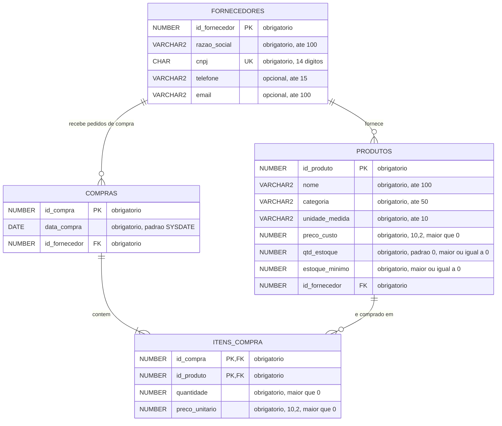

# Sistema-de-Controle-de-Estoque---BD
Controle de produtos e fornecedores, com relatórios de estoque baixo e quantidade comprada.

# Sistema de Controle de Estoque

Trabalho da disciplina **Banco de Dados** (Faesa, 2026/2), orientado pelo professor **Howard Roatti**.
Aplicação de console em Python integrada a um banco de dados **Oracle**, com controle de produtos,
fornecedores e compras, e relatórios de estoque baixo e quantidade comprada.

## Integrantes

| Nome | GitHub |
|---|---|


## Funcionalidades

- **Relatórios:** quantidade comprada por produto (agrupamento), itens de compra (junção de tabelas)
  e produtos com estoque baixo.
- **Inserir, atualizar e remover** registros de fornecedores, produtos, compras e itens de compra.
- **Splash screen** com o total de registros de cada tabela, os integrantes do grupo e os dados da disciplina.
- **Estoque automático:** inserir, alterar ou remover um item de compra ajusta a quantidade em estoque do produto.
- **Integridade na remoção:** ao remover um registro que é chave estrangeira em outra tabela, o sistema avisa
  e pergunta se deseja remover também os registros dependentes.

## Modelo relacional




| Relacionamento | Cardinalidade |
|---|---|
| FORNECEDORES — PRODUTOS | 1:N |
| FORNECEDORES — COMPRAS | 1:N |
| COMPRAS — ITENS_COMPRA | 1:N |
| PRODUTOS — ITENS_COMPRA | 1:N |

`COMPRAS` e `PRODUTOS` têm relação N:N, resolvida pela tabela `ITENS_COMPRA` (chave primária composta).

## Estrutura do repositório

```
.
├── README.md
├── PROMPTS.md                    # prompts de IA usados no projeto
├── requirements.txt
├── db/
│   └── criar_tabelas.sql         # sequences, tabelas e relacionamentos (Oracle)
├── docs/
│   └── diagrama_relacional.png
└── src/
    ├── principal.py              # programa principal (menus)
    ├── conexion/                 # conexão com o Oracle
    ├── model/                    # classes das entidades
    ├── controller/               # inserir, atualizar e remover (SQL concatenado, sem ORM)
    ├── reports/                  # classe que executa e exibe os relatórios
    ├── sql/                      # consultas SQL dos relatórios
    └── utils/                    # menus, leitura de dados e splash screen
```

## Requisitos

- Linux (ambiente da VM da disciplina)
- Python 3.9 ou superior
- Banco de dados Oracle acessível e um usuário com permissão para criar tabelas e sequences
- Biblioteca Python `oracledb` (modo *thin*: não exige Oracle Client instalado)

## Como executar (Linux)

**1. Clonar o repositório**

```bash
git clone URL_DO_REPOSITORIO
cd NOME_DO_REPOSITORIO
```

**2. Criar o ambiente virtual e instalar a dependência**

```bash
python3 -m venv .venv
source .venv/bin/activate
pip install -r requirements.txt
```

**3. Criar as tabelas no Oracle**

Execute o script `db/criar_tabelas.sql` conectado ao seu usuário, pelo SQL Developer ou pelo SQL*Plus:

```bash
sqlplus USUARIO/SENHA@HOST:PORTA/SERVICO @db/criar_tabelas.sql
```

Para recriar tudo do zero, descomente os comandos `DROP` no início do script e execute-o novamente.

**4. Configurar a conexão**

A senha não fica no código. Defina as credenciais por variáveis de ambiente:

```bash
export ORACLE_USER=seu_usuario
export ORACLE_PASSWORD=sua_senha
export ORACLE_DSN=host:porta/servico    # opcional; padrão: localhost:1521/XEPDB1
```

**5. Executar o programa**

O programa deve ser executado de dentro da pasta `src`:

```bash
cd src
python3 principal.py
```

## Como usar

1. Ao iniciar, a **splash screen** mostra o total de registros de cada tabela. Pressione Enter para continuar.
2. No **menu principal**, escolha uma opção digitando o número:
   `1` Relatórios, `2` Inserir, `3` Remover, `4` Atualizar, `5` Sair.
3. Em **Relatórios**, escolha um dos três relatórios; `0` volta ao menu principal.
4. Em **Inserir, Remover e Atualizar**, escolha a entidade (fornecedores, produtos, compras ou itens de compra).
   - *Inserir:* informe cada campo solicitado.
   - *Remover:* o sistema lista os registros, você informa o código e confirma.
   - *Atualizar:* o sistema lista os registros, você informa o código e digita os novos valores
     (Enter mantém o valor atual); o registro atualizado é exibido ao final.
5. Depois de cada operação, o sistema pergunta se deseja continuar na mesma ação (`S`/`N`).

### Ordem recomendada para o primeiro uso

Como existem dependências entre as tabelas, cadastre nesta ordem:
**fornecedor → produto → compra → item de compra**.

## Regras de negócio

- O CNPJ do fornecedor é único e tem 14 dígitos.
- Todo produto pertence a um fornecedor, e uma compra só aceita itens de produtos do fornecedor da compra.
- Preços e quantidades de itens devem ser maiores que zero; o estoque nunca pode ficar negativo.
- Um produto aparece uma única vez em cada compra (chave primária composta).
- As consultas SQL são montadas por concatenação de texto, sem uso de ORM, conforme exigido pelo edital.

## Uso de inteligência artificial

Ferramentas de IA foram usadas como apoio ao desenvolvimento. Todos os prompts, as fontes e o que o grupo
fez com cada resposta estão registrados em [`PROMPTS.md`](PROMPTS.md).
